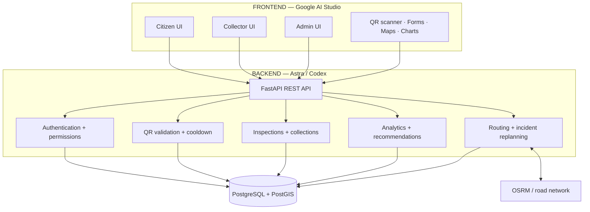
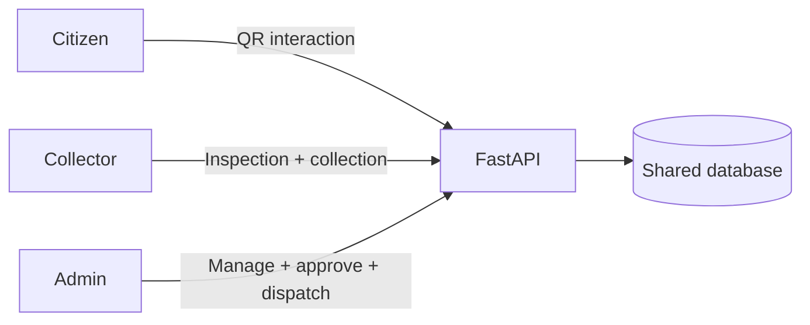
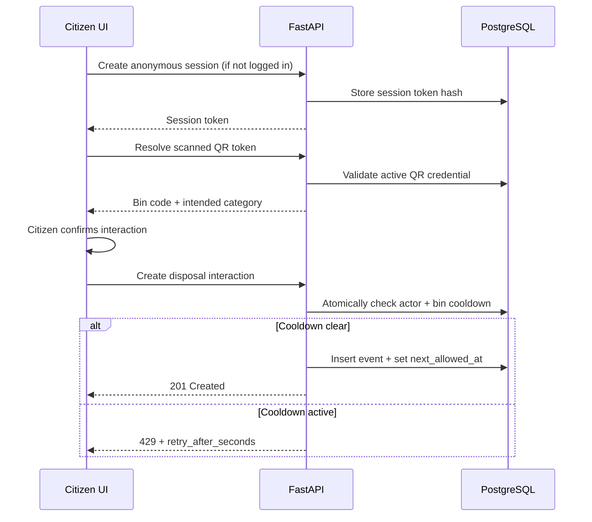
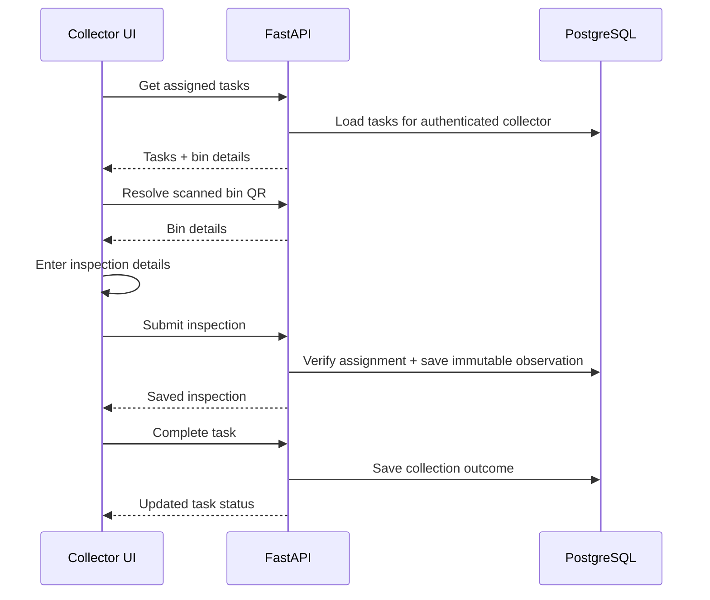
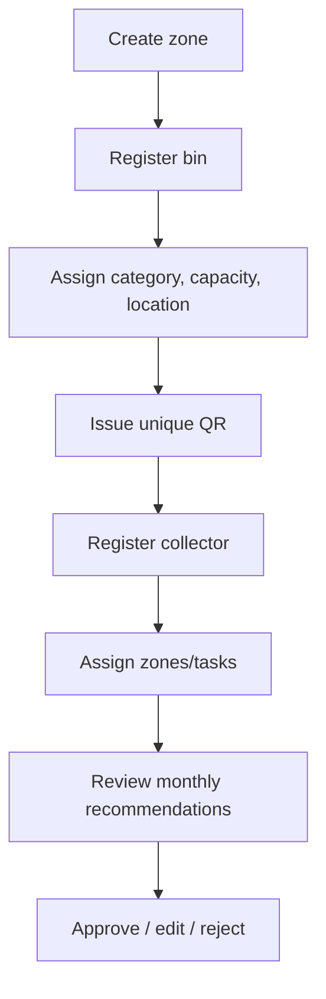
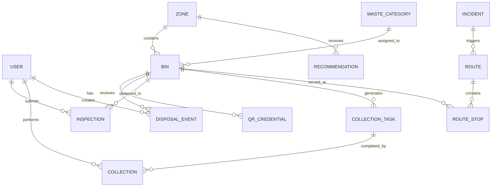

# GreenTrack — Engineering Blueprint & Integration Contract
**Version 1.0 · Proposed baseline for hackathon development**

> This is the shared technical agreement for Google AI Studio (frontend) and GPT-6 Astra/Codex (backend). Read it before generating code. The companion `openapi.yaml` is the authoritative API contract.

## 0. Non-negotiable rules

1. This blueprint and `openapi.yaml` are the single source of truth. Do not invent endpoints, fields, enum values or workflows.
2. Frontend owns presentation and user interaction. Backend owns validation, permissions, business rules, calculations and persistence.
3. Database is the source of truth. Browser state is not authoritative.
4. Google AI Studio works only in `/frontend`. Astra/Codex works only in `/backend`.
5. Neither model changes `/contracts/openapi.yaml` or this document without team approval.
6. Mock data is allowed only through a mock API adapter that returns the exact same types as the real API.
7. QR interaction is not proof of physical deposit. QR counts are not fill-level measurements.
8. Real observations, simulated demo data and forecasts must always be distinguishable.

---

# 1. System overview



**Architecture style:** modular monolith for the MVP. One FastAPI application with separate domain modules, one PostgreSQL database, and one React application. This is easier to build and deploy than microservices while preserving clean boundaries.

| Layer | Agreed technology |
|---|---|
| Frontend | React + TypeScript + Vite + Tailwind CSS |
| QR scanning | Browser camera QR library + manual token fallback |
| Maps | Leaflet + OpenStreetMap |
| Charts | Recharts |
| Backend | Python + FastAPI |
| Database | PostgreSQL + PostGIS |
| Migrations | Alembic |
| Analytics | Python + Pandas |
| Routing | OSRM + OR-Tools |
| API contract | OpenAPI 3.1 |

---

# 2. Clear ownership: frontend vs backend

## Frontend owns
- Citizen, Collector and Admin pages, navigation and responsive design.
- Camera permission and QR scanning in the browser.
- Input forms and client-side validation for usability.
- Displaying server-provided cooldowns, bin status, analytics, recommendations and routes.
- Maps, charts, loading/error/empty states.
- Calling API endpoints through a central API service layer.
- Mock API adapter for UI work before the backend is ready.

## Backend owns
- Authentication, anonymous session issuance and role permissions.
- QR token resolution and revocation.
- Enforcing the five-minute cooldown atomically.
- Creating disposal-interaction records.
- Validating collector assignments and saving inspections/collections.
- Historical data storage.
- Monthly metrics, hotspot scores and recommendations.
- Collection task creation, route optimization and Round 3 replanning.
- Audit logs and trusted timestamps.

| Business rule | Authority |
|---|---|
| Is QR token valid? | Backend |
| Can this actor act on this bin? | Backend |
| Is cooldown active? | Backend |
| Latest observed fill level | Backend, from inspection history |
| Is a zone a hotspot? | Backend |
| What is next month's recommendation? | Backend |
| Which route is valid after an incident? | Backend |
| How should data look on screen? | Frontend |

The frontend may show a five-minute timer, but it cannot decide that a scan is accepted. The backend response is final.

---

# 3. Roles and permissions



| Capability | Citizen | Collector | Admin |
|---|:---:|:---:|:---:|
| Resolve public bin QR | Yes | Yes | Yes |
| Create disposal interaction | Yes | No | Testing only |
| View own participation | Logged-in only | No | Aggregate only |
| View assigned tasks | No | Yes | Yes |
| Submit inspection | No | Yes | Correction workflow only |
| Complete collection task | No | Yes | Reassign/cancel |
| Manage zones/bins/QR | No | No | Yes |
| Register/assign collectors | No | No | Yes |
| View monthly analytics | No | Limited operational view | Yes |
| Approve recommendations | No | No | Yes |
| Create/replan routes | No | View assigned route | Yes/dispatcher |

**Security rule:** derive acting user/collector identity from the authenticated session. Never trust a `user_id` or `collector_id` sent in the request body.

---

# 4. Canonical workflows

## 4.1 Citizen QR interaction



Rules:
- Every individual bin has a unique opaque QR token.
- Citizen login is optional. Anonymous citizens first receive a server-issued anonymous session token.
- Cooldown key: `(actor identity, bin_id)`. Identity is authenticated citizen ID or anonymous session ID.
- Five minutes is enforced by server time and an atomic database operation. Different bins have independent cooldowns.
- A QR scan records an interaction only. It does not prove deposit, weight, fill level or correct segregation.
- Individual citizen points require login. Points represent participation only, not verified recycling.

## 4.2 Collector inspection and collection



Inspection fields:
- Fill percentage: 0–100.
- Overflow: yes/no.
- Observed waste condition/category.
- Contamination level: `NONE`, `LOW`, `MEDIUM`, `HIGH`.
- Estimated mixed-waste percentage: optional, only if reasonably assessable.
- Notes and optional photo.
- Source: `REAL` or `SIMULATED` for demo/testing.

Inspection records are historical events. Corrections must be amended/audited; do not silently overwrite the original. The latest valid inspection is the latest **observed** fill level. No continuous/live measurement is claimed without a sensor.

## 4.3 Admin infrastructure workflow



QR credentials are opaque and revocable. Replacing a QR revokes the old credential.

---

# 5. Domain model and database structure

## 5.1 Entity relationship diagram



## 5.2 Core tables

| Table | Important fields | Purpose |
|---|---|---|
| `users` | id, role, name, email, status | Citizen, collector, admin |
| `anonymous_sessions` | id, token_hash, expires_at | Anonymous citizen identity |
| `zones` | id, name, boundary | Campus/neighbourhood areas |
| `waste_categories` | id, code, label | Wet, plastic, paper, other |
| `bins` | id, code, zone_id, category_id, capacity_litres, location, status | Bin master records |
| `bin_qr_credentials` | id, bin_id, token_hash, issued_at, revoked_at | QR lifecycle |
| `disposal_events` | id, bin_id, actor_type, actor_id, accepted_at | Citizen interactions |
| `scan_cooldowns` | actor_key, bin_id, next_allowed_at | Atomic five-minute rule |
| `inspections` | id, bin_id, collector_id, fill_percent, overflow, contamination, inspected_at | Physical observations |
| `collection_tasks` | id, bin_id, collector_id, priority, status, due_at | Assigned work |
| `collections` | id, task_id, collector_id, status, completed_at | Collection outcome |
| `incidents` | id, type, location/road_edge, severity, status | Overflow or blockage |
| `routes` | id, version, status, distance/time estimate | Route versions |
| `route_stops` | id, route_id, bin_id, sequence, status | Ordered stops |
| `monthly_metrics` | period, scope, metric, value, sample_count | Monthly snapshots |
| `recommendations` | period, zone/bin, action_type, rationale, status | Suggested improvements |
| `audit_logs` | actor, action, entity, timestamp | Sensitive change history |

Data rules:
- Use UUID IDs and foreign keys.
- Store bin coordinates as PostGIS geography points (WGS84/SRID 4326).
- Keep inspections and collections as historical records.
- `bins` stores configuration; inspections store observed state.
- Simulated data must carry `source=SIMULATED` and be clearly labelled.
- QR scan counts never substitute for measured waste quantity.

---

# 6. API contract — shared boundary

**Base path:** `/api/v1` · **Format:** JSON · **IDs:** UUID · **Responses:** ISO-8601 UTC timestamps.

- Logged-in users: `Authorization: Bearer <token>`.
- Anonymous citizen: `X-Anonymous-Session: <session-token>`.
- Error shape: `{ "code": "...", "message": "...", "details": {} }`.
- The machine-readable `openapi.yaml` is authoritative. Do not implement an endpoint until it exists in that file.

## 6.1 Health and identity

| Method | Endpoint | Access | Purpose |
|---|---|---|---|
| GET | `/health` | Public | Health check |
| POST | `/auth/anonymous-sessions` | Public | Issue anonymous citizen session |
| POST | `/auth/login` | Public | Login |
| GET | `/me` | Authenticated | Current user and role |

## 6.2 Public bins and citizen

| Method | Endpoint | Access | Purpose |
|---|---|---|---|
| POST | `/public/bins/resolve` | Public | Resolve QR token to safe bin details |
| POST | `/citizen/disposal-events` | Citizen or anonymous | Create interaction and enforce cooldown |
| GET | `/citizen/disposal-events/me` | Logged-in citizen | Own history |

Cooldown violation returns `429 COOLDOWN_ACTIVE` and `retry_after_seconds`.

## 6.3 Collector

| Method | Endpoint | Access | Purpose |
|---|---|---|---|
| GET | `/collector/tasks` | Collector | Assigned tasks |
| POST | `/collector/bins/{bin_id}/inspections` | Assigned collector | Submit inspection |
| POST | `/collector/tasks/{task_id}/complete` | Assigned collector | Record collection outcome |
| POST | `/collector/incidents` | Collector | Report overflow or blocked access |

## 6.4 Admin and operations

| Method | Endpoint | Access | Purpose |
|---|---|---|---|
| GET/POST | `/admin/zones` | Admin | List/create zones |
| PATCH | `/admin/zones/{zone_id}` | Admin | Update zone |
| GET/POST | `/admin/bins` | Admin | List/create bins |
| GET/PATCH | `/admin/bins/{bin_id}` | Admin | Read/update bin |
| POST | `/admin/bins/{bin_id}/qr/rotate` | Admin | Replace QR credential |
| GET/POST | `/admin/collectors` | Admin | List/register collectors |
| PATCH | `/admin/collectors/{collector_id}` | Admin | Update collector |
| POST | `/admin/collection-tasks` | Admin | Create/assign task |
| GET | `/admin/analytics/monthly?period=YYYY-MM` | Admin | Read monthly snapshot |
| POST | `/admin/analytics/monthly/generate` | Admin | Generate monthly metrics |
| GET | `/admin/recommendations?period=YYYY-MM` | Admin | List plan candidates |
| PATCH | `/admin/recommendations/{recommendation_id}/decision` | Admin | Approve/reject/edit |
| POST | `/admin/incidents` | Admin | Create incident |
| POST | `/admin/routes/optimize` | Admin/dispatcher | Generate route |
| POST | `/admin/routes/{route_id}/replan` | Admin/dispatcher | Replan after incident |
| GET | `/admin/routes/{route_id}` | Admin/dispatcher | Route and ordered stops |

Exact request/response schemas and enum values are in `openapi.yaml`.

---

# 7. Business rules and intelligence

## 7.1 Cooldown
- Duration: 300 seconds.
- Key: `(actor identity, bin_id)`.
- Use server time and atomic transaction/upsert/locking.
- Two concurrent requests must not both pass.
- A different bin has an independent cooldown.
- Browser countdown is informational only.

## 7.2 Fill and contamination
- Fill percentage is validated from 0–100.
- Collector must be authorized for the bin/zone or task.
- Overflow triggers an urgent alert/task.
- Keep all inspection events.
- If no weight or quantity is measured, report contamination frequency/level—not a fabricated contamination mass percentage.

## 7.3 Monthly analysis
Include:
- Average, median and maximum observed fill.
- High-fill observation count.
- Overflow count.
- Collection interval/frequency.
- Contamination observations.
- Inspection coverage and sample count.
- Citizen interactions as a separate participation metric.

**Do not use QR scan counts as bin fullness or waste quantity.**

### Initial hotspot heuristic
A configurable score can use:
- 40% fill pressure.
- 30% overflow burden.
- 20% collection pressure.
- 10% complaint burden, if complaint data exists.

Normalize inputs to 0–100. If one component is unavailable, reweight the available components and disclose missing data. These are starting assumptions, not validated scientific coefficients.

### Recommendation types
`ADD_BIN`, `RELOCATE_BIN`, `CHANGE_CATEGORY_MIX`, `INCREASE_COLLECTION_FREQUENCY`, `INCREASE_INSPECTION_FREQUENCY`, `SEGREGATION_AWARENESS`.

Each suggestion carries period, area/bin, rationale, supporting evidence, data coverage/confidence and status. Admin approval is required before implementation.

One month of data supports rule-based baseline recommendations, not robust machine-learning claims.

## 7.4 Round 3 route replanning
- Preserve completed stops.
- Mark blocked road edge unavailable or add a large penalty.
- Raise priority for overflow bins.
- Re-optimize only pending/unserved tasks.
- Save a new route version; preserve the old one.
- Show affected bins and changed stop sequence.
- If routing fails, show manual dispatch fallback. Never invent route metrics.

---

# 8. Frontend structure — Google AI Studio owns `/frontend`

```text
frontend/
  src/
    app/                 # router, providers, auth guards
    features/
      citizen/           # QR scan, bin details, participation
      collector/         # tasks, inspection, collection
      admin/             # dashboard, zones, bins, users, plans
      analytics/         # monthly metrics, hotspot views
      routes/            # map, stops, incident display
    components/          # shared forms, tables, maps, status
    services/            # ONLY place that calls the API
    types/               # OpenAPI-aligned types
    mocks/               # mock API adapter
    config/              # environment configuration
```

Frontend rules:
- Components never call `fetch()` directly; use `services/`.
- API types must match `openapi.yaml`.
- API host comes from `VITE_API_BASE_URL`.
- `VITE_USE_MOCK_API=true` selects mock mode.
- Mock mode returns the same types and status behavior as real API.
- No database credentials or trusted business logic in browser code.

---

# 9. Backend structure — GPT-6 Astra/Codex owns `/backend`

```text
backend/
  app/
    main.py
    api/v1/              # routers matching OpenAPI paths
    core/                # config, auth, permissions, errors
    models/               # SQLAlchemy models
    schemas/              # Pydantic request/response models
    services/
      qr_service.py
      cooldown_service.py
      inspection_service.py
      collection_service.py
      analytics_service.py
      hotspot_service.py
      recommendation_service.py
      routing_service.py
    jobs/                 # monthly analytics / reminders
    db/                   # session and base
    tests/
  alembic/                # database migrations
```

Backend rules:
- Endpoints match OpenAPI exactly.
- Validate with Pydantic.
- Enforce permissions in backend dependencies/services.
- Use transactions for cooldown and important state changes.
- Derive actor IDs from authentication, not request bodies.
- Keep calculations in service modules, not route handlers.
- Use Alembic migrations.
- Test cooldown concurrency, role permissions, inspections, recommendations and route replanning.

---

# 10. Repository, branches and integration

```text
greentrack/
  contracts/
    openapi.yaml              # shared API source of truth
  docs/
    ENGINEERING_BLUEPRINT.md  # this document
  frontend/                   # Google AI Studio only
  backend/                    # Astra/Codex only
  README.md
  .env.example
```

| Branch | Owner | Permitted changes |
|---|---|---|
| `main` | Human/team | Approved tested merges |
| `frontend-work` | Google AI Studio | `/frontend/**` only |
| `backend-work` | Astra/Codex | `/backend/**`, tests, migrations |
| `contract-change` | Human/team approval | `/contracts/**` and `/docs/**` |

Do not let both models write to `main` simultaneously.

## Integration order
1. Team approves architecture and OpenAPI.
2. Backend creates migrations and API skeleton.
3. Frontend builds against OpenAPI with mock adapter.
4. Backend exposes running API and OpenAPI documentation.
5. Frontend switches from mock to real API.
6. Test all three roles end-to-end.
7. Test overflow/blocked-road Round 3 flow.
8. Merge only after tests pass.

---

# 11. Definition of done

| Module | Acceptance condition |
|---|---|
| QR | Valid token resolves; revoked/unknown token rejected |
| Cooldown | Repeat within five minutes returns 429; concurrent requests cannot bypass |
| Inspection | Authorized collector saves fill and contamination with server timestamp |
| Collection | Task changes only through authorized action |
| Admin bins | Create/update/deactivate and rotate QR |
| Monthly analytics | Metrics show sample count and inspection coverage |
| Recommendations | Every suggestion has rationale/evidence and admin decision |
| Routes | Pending tasks produce a route or explicit fallback |
| Round 3 | Incident updates priorities and saves a new route version |

---

## Core engineering principle

**GreenTrack separates activity from evidence, and evidence from decisions.**

- Citizen QR interactions show participation.
- Collector inspections show observed physical condition.
- Collection records show service outcomes.
- Historical analysis identifies area-level needs.
- Recommendations help admins decide what to change.
- Route optimization helps operators execute collection.

This separation is the foundation of a reliable product and the agreement that keeps its frontend and backend compatible.
